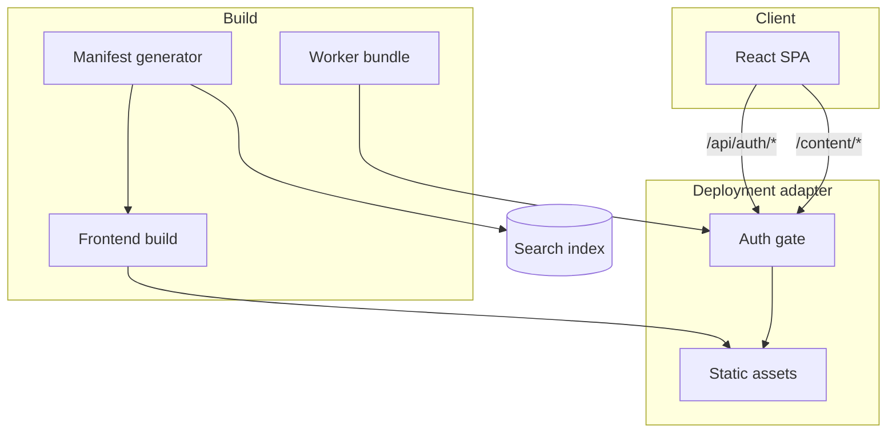

# Architecture Overview

Ry-Mark is a client-side documentation platform with a thin, security-focused server layer.

## Component map

## Layers

| Layer | Location | Responsibility |
| ----- | -------- | -------------- |
| Rendering core | `src/features/document-rendering/core` | Stable renderer interface + registry |
| Engine | `src/features/document-rendering/engines/react-markdown` | The only place react-markdown is imported |
| Content | `content/` + `scripts/build-content.mjs` | Source of truth and generated manifest |
| Auth core | `shared/auth-core/` | Password, sessions, config — shared by all adapters |
| Adapters | `worker/`, `server/`, `dev-server/` | Runtime plumbing only |

## Key decisions

:::note
The Markdown engine is **replaceable by design**: the application only imports from the feature's public `index.ts`, never from `react-markdown` directly.
:::

1. **Fail closed** — missing secrets never unlock content.
2. **No database** — signed, stateless sessions.
3. **Advanced-mode worker** — required on Cloudflare because static assets would otherwise bypass any Function.
4. **Shared auth core** — Cloudflare, Node and dev adapters share one implementation.

See [API conventions](./Backend/API.md) for endpoint details and the [Database notes](./Backend/Database.md) for why there is no database.
