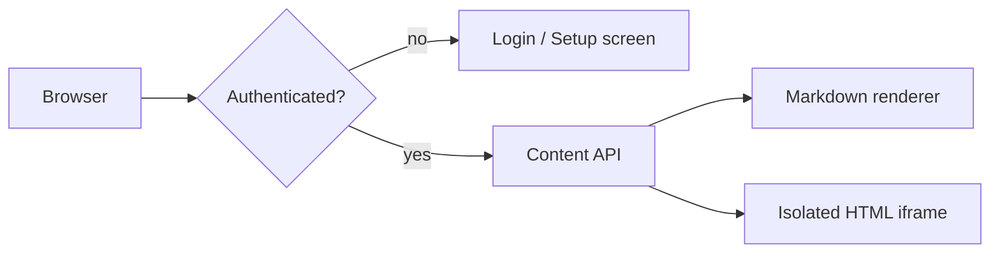
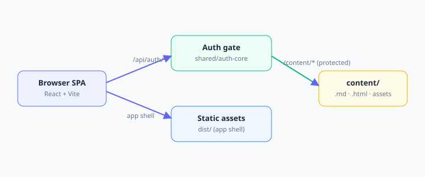

# Welcome to Ry-Mark

Ry-Mark is a **private, polished documentation viewer** for Markdown and HTML documents. This sample collection demonstrates every supported feature.

:::note{title="Tip"}
Press <kbd>Ctrl</kbd> + <kbd>K</kbd> anywhere to open the search palette.
:::

## Markdown essentials

### Text and lists

Text supports **bold**, *italic*, ~~strikethrough~~, `inline code`, and [links](./Tutorials/Docker.md) to other documents.

- Unordered lists nest cleanly
  - Like this
- Ordered lists too
  1. First
  2. Second

### Task lists

- [x] Render Markdown beautifully
- [x] Protect content with authentication
- [ ] Write more documentation

### Tables

| Feature | Markdown | HTML |
| ------- | :------: | :--: |
| Rendered by engine | ✅ | — |
| Isolated iframe | — | ✅ |
| Searchable | ✅ | ✅ |

## Code

Fenced code blocks are highlighted with [Shiki](https://shiki.style) and include a copy button:

```typescript
// Typed renderer abstraction — swap engines without touching the app.
export interface MarkdownRenderer {
  render(source: string): Promise<string>;
}
```

## Math

Inline math like $E = mc^2$ and display math:

$$
\int_{-\infty}^{\infty} e^{-x^2} \, dx = \sqrt{\pi}
$$

## Diagrams



## Callouts

:::note
Use **note** for neutral supplementary information.
:::

:::info{title="Good to know"}
`info` callouts are blue and can have custom titles.
:::

:::success
Great — everything is configured correctly.
:::

:::warning
Warnings draw attention to potential problems.
:::

:::danger
Danger callouts are reserved for destructive operations.
:::

## Custom components

### Tabs

:::::tabs
::::tab[npm]
```bash
npm install
```
::::
::::tab[pnpm]
```bash
pnpm install
```
::::
:::::

### Cards

:::::cards
::::card[Markdown engine]
React-markdown with a replaceable adapter — swap engines without touching the app.
::::
::::card[HTML documents]
Real HTML files rendered in a sandboxed iframe with working assets and scripts.
::::
::::card[Password protection]
One shared password, HMAC-signed sessions, zero database.
::::
:::::

### Badges

Status: :badge[Stable]{tone=success} · Build: :badge[Passing]{tone=info} · License: :badge[MIT]

### File trees

:::::filetree
::::dir[content]
::file[README.md]
::file[Architecture.md]
:::dir[Backend]
::file[API.md]
::file[Database.md]
:::
::::
:::::

## Project structure



---

Continue with the [Architecture overview](./Engineering/Architecture.md) or the [Docker tutorial](./Tutorials/Docker.md).
